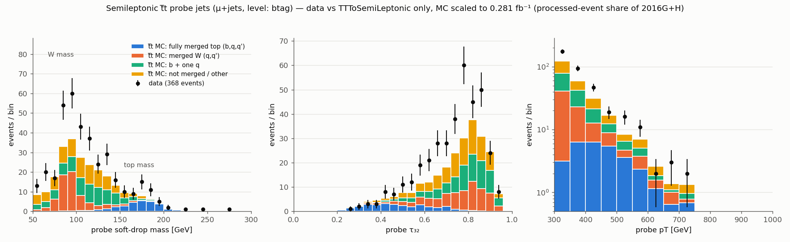

# Top-enriched AOJ jets from semileptonic ttbar (R&D)

Tag-and-probe in lepton+jets ttbar: the **tag** side (one isolated lepton, MET, a b-tagged AK4 jet)
selects ttbar without looking at the jet; the **probe** is an AOJ AK8 jet (same definition as
`H5_maker.py`), which in ttbar is often the hadronic top. Output = AOJ jet-level HDF5 (same datasets as
`H5_maker.py`, incl. `PFCands` when the input is PFNano) + tag-side info + MC truth.

## Selection (`ttbar_selection.py`)

Default (`--preset an`): the ttbar tag-and-probe **implementation** of CMS HIG-24-010 (from its analysis
note), adapted to 2016 UL NanoAOD and to the AOJ jet definition (the probe must be an AOJ jet; the extra-AK8
veto is raised from 160 to 300 GeV, the AOJ probe threshold: ~3x the events at the same top purity). Cut flow
(cumulative, per channel `mu` / `el`; override any cut with `--set name=value`):

| stage | requirement (`DEFAULT_CUTS` == `PRESETS["an"]`) |
|---|---|
| `trigger` | 2016: mu `HLT_IsoMu24 \|\| HLT_IsoTkMu24` (the analysis note uses IsoMu27; this OR is what the 2016 UL muon trigger SFs are measured for), el `HLT_Ele27_WPTight_Gsf \|\| HLT_Ele32_WPTight_Gsf` (Ele32_WPTight does not exist in Run2016G; Ele27_WPTight is its unprescaled 2016 counterpart). 2017/18: IsoMu27 / Ele32_WPTight_Gsf. `--trigger jetht` = OR of the 85 AOJ JetHT paths instead |
| `filters_json` | the 8 AOJ MET filters (absent = skipped, as H5_maker) + golden JSON (data) |
| `one_lepton` | exactly one tag lepton, no other isolated lepton with pT > 30. Tag mu: pT > 55, \|eta\| < 2.4, tightId, pfRelIso04 < 0.15. Tag e: pT > 55, \|eta_SC\| < 2.4 outside 1.4442–1.566, mvaFall17V2Iso_WP80. Other isolated leptons: mu looseId + iso < 0.25; e cutBased >= 1 |
| `met` | `MET_pt` > 50 |
| `one_probe` | exactly one AK8 jet with pT > 300, \|eta\| < 2.5 (`fj_count_min_pt`; the analysis note vetoes other AK8 jets above its 160 GeV probe threshold, `--preset an160`), and it is an AOJ jet (jetId == 6); no mSD cut (`fj_min_msd`, 0 = off) |
| `dphi` | dphi(tag lepton, probe) > 2.0 (back to back) |
| `btag` | >= 1 AK4 jet pT > 40, \|eta\| < 2.4, tight ID, DeepJet medium (UL16 post-VFP 0.2489), dR(b, probe) > 1.5, dR(b, lepton) > 0.5 |
| `tau32` | probe tau3/tau2 < 0.5 (from the paper; optional last stage, decision stored as `pass_tau32`) |

`--preset paper` = the region as worded in the HIG-24-010 paper (lepton pT > 50, veto leptons > 10, e
\|eta\| < 2.5, an AK8 jet with mSD > 50 and no other AK8 jet above 300, no dphi cut, b pT > 30 with
dR > 0.8 / 0.4 for "well separated", triggers IsoMu24/IsoTkMu24/Mu50/TkMu50 and Ele27/Ele115); this was
the default before 2026-10-13 (`rnd/out_v1_paper`, `rnd/purity_v1_paper.txt`).

`--preset skim` = a loose superset for offline cuts (more statistics, and an anti-isolated sideband for a
data-driven QCD estimate): the "an" OR the high-pT lepton paths (IsoMu24/IsoTkMu24/Mu50/TkMu50,
Ele27/Ele32_WPTight/Ele115), a tight-ID lepton with pT > 30 and relIso < 1 (electrons: no-iso MVA WP80 and
pfRelIso03 < 1), no extra-lepton veto, MET > 20, any number of AK8 jets above 300 (probe = the leading AOJ
jet with dR(lepton) > 0.8); dphi / btag / tau32 as in "an". The tag lepton is the "an"-tight one whenever
the event has one, so "an" is recovered exactly offline: `an_channel == channel`, the "an" trigger bits
(`trig_mu_an` / `trig_el_an`, or `trig_jetht` with `--trigger lepton_or_jetht`), `met_pt > 50`,
`n_ak8 == 1` (checked on 20k TTToSemiLeptonic events: the same 110 events from the dphi stage on, with
identical values). On those events it keeps ~3x the "an" rows at every stage. Every preset also writes the
columns `lep_reliso`, `lep_id_iso`, `an_channel`, `n_lep_tight`, `n_veto_mu`, `n_veto_el`, `ak8_other_pt`
(leading other AK8 jet, any pt: offline veto scans), `trig_mu_an`, `trig_el_an` (appended to `ttbar_tag`;
the first 28 columns and all other datasets are unchanged).

Scale factors (POG correctionlib files, `/cvmfs/cms.cern.ch/rsync/cms-nanoAOD/jsonpog-integration/POG/`,
2016postVFP_UL): muon trigger SFs exist for `IsoMu24_or_IsoTkMu24` (denominator: tight ID + tight PF iso, i.e.
this tag muon; binned in |eta| 0–2.4 and pT 26–inf, ~0.95–0.99 above 55 GeV, with stat/syst variations: weight
MC by SF(|eta|, pT) of the tag muon) and `Mu50_or_TkMu50`, not for IsoMu27 or IsoMu24 alone; EGamma provides electron ID (incl. `wp80iso`) and reco
SFs but **no electron trigger SFs** (measure them, e.g. tag-and-probe in Z->ee or with an orthogonal trigger).

MC truth (`gen_truth`): partons of each hadronic W (and its top's b) within dR < 0.8 of the probe:
`t` (b, q, q'), `W` (q, q'), `bq` (b + one q), `other`.

## Usage

```bash
# from AOJProcessing/; ttbar_semilep/py3env.sh = isolated python3 (LCG_105a; on EL8 it re-runs itself in cmssw-el9)
bash ttbar_semilep/py3env.sh ttbar_semilep/ttbar_maker.py -i nano_data2016.root -o tt.h5 --sample_type data \
     -j Cert_271036-284044_13TeV_Legacy2016_Collisions16_JSON.txt          # SingleMuon / SingleElectron
bash ttbar_semilep/py3env.sh ttbar_semilep/ttbar_maker.py -i nano_mc2016post.root -o tt.h5 --sample_type MC \
     --trigger lepton_or_jetht --store one_probe                              # keep everything for studies
bash ttbar_semilep/py3env.sh ttbar_semilep/ttbar_summary.py --lumi 16.39 --mc TTToSemiLeptonic:365.34:'tt_*.h5' \
     --data SingleMuon:1:'sm_*.h5' --route lepton
bash ttbar_semilep/py3env.sh ttbar_semilep/tests/test_ttbar.py               # tests (toy + real-file, skip if missing)
```

Self-contained: the AOJ trigger/filter lists, golden-JSON mask and AOJ jet definition are a copy
(`aoj_common.py`) of `event_level/aoj_selection.py`; a test checks them against `H5_maker.py` (and against
`event_level/` when present).

`--store` (default `btag`) sets which events are written; `ttbar_tag/stage` records how far each stored event
got (index in `cutflow.attrs["stages"]`), so the default output holds the substructure-unbiased (`btag`) sample
and the final (`tau32`) one, and a looser `--store` can be cut offline. Inputs: AOJ
Stage-1 PFNano (`pfnano_*_2016UL_OpenData.py` output; has every branch needed) or any UL NanoAOD (no `PFCands`).

## CR samples, outputs (format 3) and production

**Samples** (`samples.py`): the one list for the control region (2016G+H data, UL16 post-VFP MC): group, the
channels each sample models, Open Data record, cross section used and its source (and the record's own value).
**Only public CMS Open Data**: every `file_lists/<label>.txt` holds eospublic paths (`--make-lists` writes the
missing ones from the record's file index). Files marked "on demand" (on tape at CERN: most V+jets, single-top tW,
MuEnriched QCD, DY and ttZ records) must be requested on the record page before the jobs can read them
(`python3 ttbar_semilep/samples.py --status`). `--regen GROUP` prints Condor `regen_lists.txt` lines.

| group | samples |
|---|---|
| ttbar | TTToSemiLeptonic, TTTo2L2Nu (TTToHadronic is the fine-tuning signal: not in the CR MC, 0.03 % of the region) |
| single top | tW top / antitop, t-channel top / antitop, s-channel |
| W(lnu)+jets, DY(ll, m > 50) | HT-binned, 70 ... 2500-inf (8 bins each) |
| W(qq)+jets, Z(qq)+jets | HT-binned, 200 ... 800-inf (4 bins each) |
| VV, ttV | WW, WZ, ZZ; ttZ(llnunu) (no UL16 ttW or ttH on the portal) |
| QCD | mu channel: MuEnriched, pT-hat 120 ... 1000-inf; e channel: inclusive pT-hat 120 ... 3200-inf (half of the CR's QCD is below pT-hat 300). The HT-binned QCD of `ttbar_skim/` is retired |
| data | SingleMuon (mu), SingleElectron (e), 2016G and 2016H: an event in both is counted once |

**Outputs** (`attrs["format_version"] = 3`; format-2 files are the first 37 `ttbar_tag` / 6 `truth` columns):
- `ttbar_tag` adds trigger bits, PV and pileup, Puppi MET, lepton SC eta / impact parameters / mini-isolation,
  2D-isolation inputs, AK4 multiplicity / HT / b tags, and the probe's ungroomed mass, N3, DeepAK8 top scores and
  subjet b tag (its `doc` attribute). 2D isolation: `lep_jet_dr` / `lep_jet_ptrel` refer to the nearest AK4 jet
  (pT > 15, |eta| < 2.4) after the lepton is taken out of the jet that contains it (`Muon/Electron_jetIdx`; raw
  jet minus lepton, times the JEC). Without that the nearest jet is the lepton's own for ~98 % of isolated leptons.
- `ak4` (N, 10, 7): the event's AK4 jets with tight ID, pT > 20, |eta| < 2.5 (pt, eta, phi, DeepJet, hadron
  flavour, dR to the probe and to the lepton), for b-tag event weights and offline b-tag selections.
- `lumis` (M, 2): every processed lumi section (data: certified ones), i.e. the luminosity the file covers.
- `truth` adds the last-copy top and antitop pT (top-pT reweighting).

**Pre-filter** (`pfnano_ttskim.py`, Condor `AOJ_TTBAR=only`): wraps the Stage-1 PFNano config so that only events
with a lepton (pT > 20) and an AK8 jet (pT > 200) are written, looser than any preset; `genWeightsTable` stays on
an unfiltered path, so `Runs/genEventSumw` counts every event. Checked with 2,000 TTToSemiLeptonic events (the
first input file of `ttbar_skim/` chunk `sub0000`), with and without it: 13 % of the events written, identical
stored probes and columns, cut flow from `one_probe` on, `Runs/genEventSumw` and lumi list; and the 28 probes are
bit-identical (PFCands, kinematics, the format-2 columns) to the production `ttbar_skim/` chunk.

**Production** (`condor/README.md`): pack the format-3 code once (`condor/pack_ttbar.sh`, `ttbar_semilep_v3.tar.gz`),
then per group, MC and data into one directory:
```bash
python3 ttbar_semilep/samples.py --regen ttbar single_top > condor/regen_lists.txt     # etc., every CR group
cd condor && AOJ_TTBAR=only AOJ_TTBAR_PRESET=skim AOJ_TTBAR_SUBDIR=ttbar_skim_v3 ./run.sh jobs && ./run.sh submit
```

## R&D results with the default (analysis-note) selection (`rnd/compare_an_vs_veto300.txt`, `rnd/purity_an*.txt`)

Same samples as v1 below (UL16 NanoAODv9 subsets from FNAL; data projected to 2016G+H by event count; MC
normalised to 16.39 fb^-1; no SFs / top-pT reweighting), 2016 muon trigger IsoMu24 || IsoTkMu24 (the IsoMu27
runs, `rnd/*_isomu27*`, agree within ~1-2 %). mu + e combined, +- MC statistics (`rnd/compare.py`):

| stage, pT > | `an160` (veto any other AK8 > 160): data G+H (raw) | tt / all MC | top purity | default `an` (veto at 300): data (raw) | tt / all MC | top purity |
|---|---|---|---|---|---|---|
| btag, 300 | 9.7k (309) | 0.82 | 0.063 +- 0.003 | 28.0k (886) | 0.80 | 0.071 +- 0.002 |
| btag, 400 | 2.0k (66) | 0.82 | 0.19 +- 0.01 | 8.1k (247) | 0.81 | 0.16 +- 0.01 |
| tau32, 300 | 525 (15) | 0.97 | 0.67 +- 0.03 | 1.6k (47) | 0.89 +- 0.06 * | 0.63 +- 0.05 * |
| tau32, 400 | 286 (7) | 0.98 | 0.85 +- 0.03 | 807 (23) | 0.96 | 0.83 +- 0.02 |
| tau32, 500 | 19 (1) | 0.98 | 0.87 +- 0.05 | 207 (6) | 0.96 | 0.83 +- 0.03 |

\* driven by a single QCD MC event (weight ~136); no QCD MC event survives tau32 with the 160 GeV veto, so the
QCD level is MC-statistics limited either way. Top purity = fully merged top probes (ttbar + single top) / all
MC; tt / (tt + QCD) is ~1.0 except for that event. The `an` selection keeps 5.2e-5 (mu) + 3.6e-5 (e) of all
semileptonic ttbar (~6x fewer than v1): the veto on any other AK8 jet above 160 GeV (`one_probe` keeps 2.6 % of
ttbar after MET vs 6.5 % in v1) and the tighter b-jet separation cost most. Raising the veto to 300 GeV gives
~3x the events at the same top purity within the MC statistics (~1000 fully merged tops after tau32 at
pT > 300, ~670 at pT > 400, vs ~350 / ~240). Before tau32 (substructure-unbiased, e.g. for template fits):
~2000 tops among 28k events (veto 300).

Final-selection composition with the default (`rnd/breakdown_default.txt`, fractions of all MC, mu + e;
"top" = ttbar + single top split by probe truth):

| pT bin | data G+H | fully merged t | merged W | b + q | other top | W+jets | QCD |
|---|---|---|---|---|---|---|---|
| 300-400 | 775 | 0.41 +- 0.03 (0.48 w/o the QCD event) | 0.17 | 0.14 | 0.12 | 0.01 | 0.15 +- 0.15 (1 raw MC event) |
| 400-500 | 599 | 0.83 +- 0.05 | 0.06 | 0.06 | 0.05 | 0.01 | 0 (0 raw) |
| > 500 | 207 | 0.83 +- 0.07 | 0.04 | 0.05 | 0.08 | 0.01 | 0 (0 raw) |
| > 300 | 1581 | 0.63 +- 0.03 (0.68) | 0.11 | 0.09 | 0.09 | 0.01 | 0.07 +- 0.07 |

## R&D results, v1 = paper-like selection (2026-10-13, small samples; projected to 2016G+H = 16.39 fb^-1)

Inputs: 2 files UL16 TTToSemiLeptonic NanoAODv9 (2.69M events; sigma = 365.34 pb), SingleMuon NanoAODv9 6 files
(5.5M events, x58 to G+H by event count), SingleElectron 2 files (1.6M, x179), JetHT 4 files (3.3M, x74). Data
"projected" = raw count x scale; numbers in () are raw events. MC has no W+jets/single top/QCD yet (LPC).

| level (pT > 300) | ttbar MC mu / e | data mu (SingleMuon) | data e (SingleElectron) | ttbar fraction mu / e |
|---|---|---|---|---|
| one_probe | 22.1k / 16.5k | 58.1k (995) | 34.0k (190) | 0.38 / 0.49 |
| **btag** (no substructure cut) | 14.7k / 10.8k | 21.5k (368) | 14.0k (78) | 0.68 / 0.77 |
| **final** (tau32 < 0.5) | 1.70k / 1.26k | 1.81k (31) | 1.25k (7) | ~0.9-1 (stat. limited) |

Fully-merged top fraction of the ttbar probes (truth `t`), mu+e:

| | pT > 300 | pT > 400 | 500-600 | > 600 |
|---|---|---|---|---|
| btag | 0.12 | 0.29 | ~0.38 | ~0.48 |
| final (tau32 < 0.5) | 0.58 | 0.73 | ~0.75 | ~0.7 |
| final + dphi(lep, probe) > 2 | 0.71 | 0.85 | | |

Variants (ttbar MC, mu+e, pT > 300 yield / f_t): btag + 105 < mSD < 210: 13.0k / 0.22; btag + PN TvsQCD > 0.5:
8.3k / 0.36; final + dphi > 2: 2.2k / 0.71 (`dphi_lep_probe` is stored, so this can be applied offline).

JetHT route (`--trigger jetht`, i.e. events that are in AOJ): btag mu 14.1k (191), e 10.4k (141); pT > 400:
6.3k mu (lepton route: 5.8k), i.e. as efficient as the lepton triggers at high pT; 88–91 % of them also fire
a single-lepton path; final 1.5k mu + 1.3k e. These probes ARE AOJ jets: running this selection on the JetHT
NanoAODv9 (Open Data 30525/30558) gives an event list to tag the existing AOJ jets (match on run/lumi/event and
dR, since the NanoAODv9 and AOJ-PFNano JECs can differ slightly).



### v1 with background MC (`rnd/`; output in `rnd/purity_v1_paper.txt`)

UL16 NanoAODv9 subsets read from FNAL (`rnd/make_jobs.py`, `rnd/run_jobs.sh`): ttbar (semilep + dilep) 4.7M,
single top (tW, t-ch) 6.1M, W+jets HT >= 100 3.7M, QCD MuEnriched pT-hat >= 170 14.7M (mu), QCD HT >= 300 9.7M (e);
data SingleMuon 12.1M / SingleElectron 6.4M events. HIG-24-010 = btag + tau32 < 0.5.

| (pT > 300 / > 400) | tt/(tt+QCD) mu | tt/(tt+QCD) e | tt / all MC mu | tt / all MC e | top purity (t from tt + 1top) mu / e | data G+H mu + e |
|---|---|---|---|---|---|---|
| btag | 0.93 / 0.96 | 0.99 / 0.98 | 0.79 / 0.77 | 0.83 / 0.78 | 0.09 / 0.22 (both) | 33.4k / 10.2k |
| **HIG-24-010** | 0.93 / 0.995 | 0.985 / 0.97 | 0.86 / 0.92 | 0.90 / 0.88 | 0.50 / 0.68 (mu), 0.50 / 0.65 (e) | 3.3k / 1.7k |
| + dphi(l,J) > 2 | 0.91 / 0.998 | 0.99 / 0.98 | 0.87 / 0.95 | 0.93 / 0.92 | 0.63 / 0.83 (mu), 0.68 / 0.80 (e) | 2.1k / 1.2k |

Tightness (TTToSemiLeptonic): the full selection keeps 2.9e-4 (mu) + 2.2e-4 (e) of all events; the costly cuts
are one_probe (6.5 %: a pT > 300, mSD > 50 AK8 jet) and tau32 (12 % of btag-level ttbar probes; ~54 % of
fully-merged tops). Non-ttbar after HIG-24-010 is mostly single top (5 %, itself mostly real tops), W+jets (3 %)
and QCD (~1–7 %, poorly known: 35 raw MuEnriched / 4 raw QCD-HT events survive). Data/MC = 0.91 at btag level and
0.85 at HIG-24-010 level (no top-pT reweighting or b-tag / lepton / tau32 scale factors applied).
LCG_105a has no el8 build: `ttbar_semilep/py3env.sh` re-runs itself inside `cmssw-el9` on el8 hosts, and
`rnd/run_jobs.sh` does the same for the R&D jobs.

Speed: ~1 min per 1.5M-event NanoAODv9 file read remotely from FNAL (only the ~80 needed branches), ~10 min
from the UAF ceph JMENano copies; eospublic xrootd direct reads timed out with uproot's default 30 s
(`--timeout`, default 600 s) and whole-file xrdcp from eospublic ran at ~0.3 MB/s from the UAF.

## Inputs on the Open Data portal (2016G+H, same CMSSW_10_6_30 / 106X_dataRun2_v37 as AOJ JetHT)

| PD | MINIAOD G / H (record) | NanoAODv9 G / H (record) | events G / H |
|---|---|---|---|
| SingleMuon | 30513 / 30546 (1089 + 1356 files, 9.3 TB) | 30530 / 30563 | 149.9M / 174.0M |
| SingleElectron | 30512 / 30545 (1331 + 1173 files, 9.3 TB) | 30529 / 30562 | 153.4M / 129.0M |
| JetHT (AOJ) | 30508 / 30541 | 30525 / 30558 | 120.7M / 124.1M |

Golden lumi (record 1059): 7.653 + 8.740 = 16.39 fb^-1. UL16 post-VFP MC: TTToSemiLeptonic 67992 (MINIAOD,
145M events) / 67993 (NanoAODv9), TTTo2L2Nu 67800, W+jets HT bins 69720–69734, single top 64634–64894,
QCD MuEnriched 63145–63237 (2016 eras B–F are not on the portal). A muon can be in both SingleMuon and
SingleElectron: the channels here are exclusive by offline lepton content, so take mu from SingleMuon and el
from SingleElectron.

## Tests (`tests/test_ttbar.py`)

Toy events per cut (incl. boundaries, vetoes, probe choice, trigger modes, golden JSON, eras), toy GenPart
chains for the truth categories (incl. all-hadronic and W+jets-like), a toy NanoAOD file end to end
(cut flow, stored rows, H5_maker's PFCands convention: first 150 linked candidates then pt-sorted), and on
real files: the vectorised selection == an independent per-event loop (20k ttbar events), truth sanity on
TTToSemiLeptonic, and `PFCands` == H5_maker's construction on the AOJ PFNano file.
